## 更新履歴 -Update
- 2026/11/4 Laravel Laravel 11.31.0 → Laravel 13.39.0にアップデートしました / PHP 8.3.36に対応しました。
- 2026/11/4 セキュリティの都合上、Captcha機能を削除しました。
- 2025/01/28 HTML Maker機能をリリース 全ページをHTMLファイルでダウンロードできるようになりました
- 2025/01/28 ログインするときのCaptcha機能をオフにする設定を追加しました
- 2024/11/15 Laravel8→Laravel11.31.0へバージョンアップ※PHP8.2以上
- 2023/10/4  サイトマップ自動生成機能のlocdateをW3C形式に修正
- 2023/6/30  サイトマップ自動生成機能を追加
- 2022/10/31 記事のプレビュー機能を追加
- 2022/9/5   TOPページのOGPタグmodified_dateを最後に更新された記事の更新日になるように修正
- 2022/6/28  本文中にscriptタグがある記事を再編集するときに一定の操作を行うと表示が崩れる問題を修正
- 2022/4/8   予約投稿記事の更新日が過去のものになるケースを修正
- 2022/3/3   自動目次機能を追加しました。

## 梅子-Umeko-
梅子はウェブページを管理するCMSアプリケーションです。 
Naho Osadaによって開発されました。 
梅子は主にブログのような、「更新頻度がそれなりに高い」ものに向いています。 

## あなたが梅子-Umeko-を使うことで得られるメリット -Benefits you get from using Umeko
- インターネット上にあなたのブログを公開できます
- 強制更新がないので、安定して使い続けられます
- 更新があっても、それを適用するかは自身で選択できます
- 複雑な機能がないので、新しく覚えることが多くありません
- 機能の追加、編集ができます（PHP、HTML、CSSなどの基本的な知識と、Laravelの知識があると尚良いです）
- MITライセンスなのであなたの責任範囲で自由に利用できます
- 社内環境やローカル環境に梅子CMSを設置すれば、HTML出力でFTPアップロードをする運用が可能です。インターネット上に梅子CMSを設置しない分、万一の悪用の心配を減らせます

## 梅子-Umeko-の開発者コメント -Developer comments
私事ですが、開発者の中高生時代（2000年頃です）から様々なブログサービスを使って作成しては破棄、を繰り返してきてました。 
初めて就職した会社がウェブサイト管理CMSを販売する会社で、そこのCMSの開発や別途納品するシステムの開発をしていました（すごく雑に言うとWordPressの日本企業版です）。 
子どもの頃から興味もあった「インターネット上に記事を書くこと」に加え、仕事のひとつとしても経験したことでいつかこれを自作してみたいと思っていました。 
その思いが形になったものが「梅子-Umeko-」です。

## 梅子-Umeko-の機能紹介 -Function introduction

### 管理画面ログイン -Management screen login
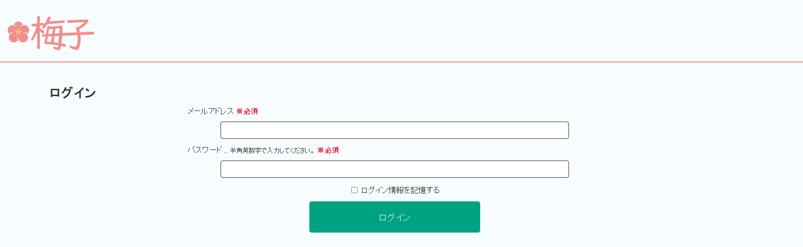

登録したメールアドレス、パスワードを入力してログインします。 

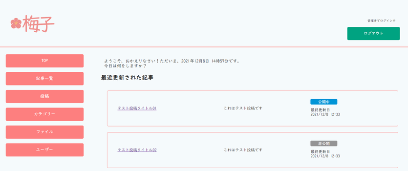

ログイン後は最近更新された記事の一覧を表示します。 
ログイン権限は管理者と一般ユーザーがあります。 
管理者はすべての情報を操作できます。一般ユーザーは自分が登録した情報のみ操作ができます。 

### ユーザーの管理 -User management
ユーザー情報の管理をする機能です。

#### 管理者 -Administrator
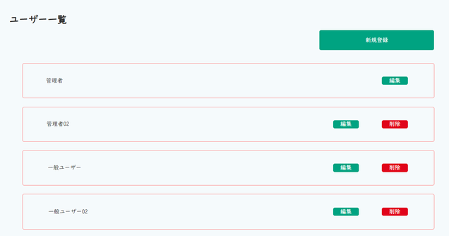

登録されているユーザーの確認、登録、削除ができます。 
この画面は管理者ユーザーのみの機能です。

#### 一般ユーザー -General user
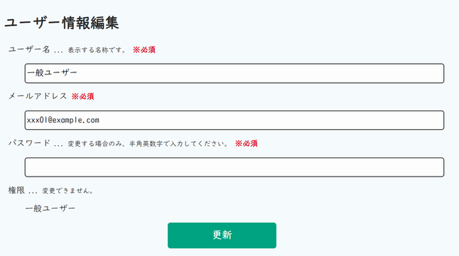

一般ユーザーの場合は自分の情報のみ閲覧できます。 
試験用データで一旦ログインし、ユーザー画面から自分が使用する管理者ユーザーを登録します。 
一旦ログアウトして、登録したユーザーでログインします。あとはそのユーザーで不要なデフォルトデータを削除することで使用できるようになります。

### 記事の管理 -Article management
梅子の最重要の機能です。公開サイトのページ情報を管理します。

#### 記事の一覧 -List of articles
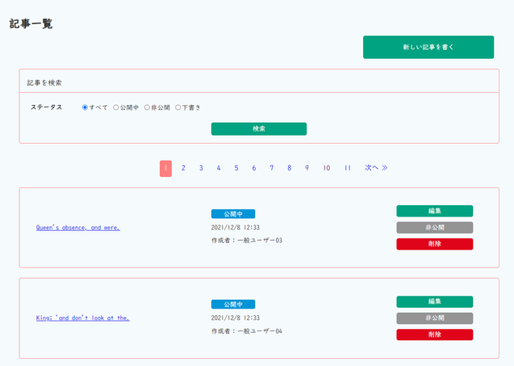

登録されている記事の一覧が確認できます。 
管理者はすべての記事、一般ユーザーは自分で書いた記事のみ表示されます。 
この画面から公開ステータスの変更ができます。

#### 記事の投稿、編集 -Posting and editing articles
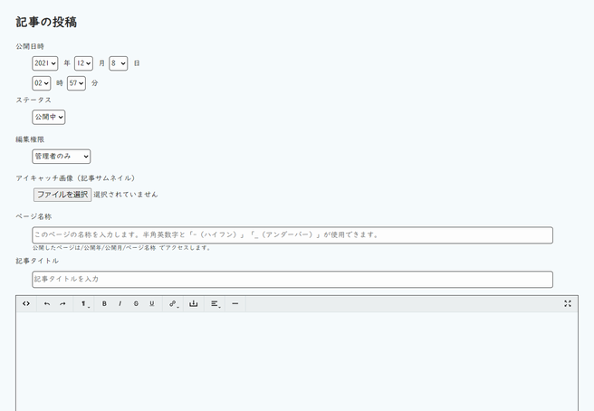

梅子の最大の機能、公開する記事の登録、編集、削除ができます。 
エディタは<a href="https://alex-d.github.io/Trumbowyg/">Trumbowyg</a>を使用しています（Thanks!）。 
画像のアップロードも可能です。 
公開ステータスは公開中、非公開、下書きの3種類があります。公開中ステータスのもののみ、ログインなしでアクセスできます。 
記事のURLは「/公開年/公開月/ページ名称」でアクセスします。 
また、記事の登録、編集、削除をするとサイトマップが自動で生成されます。 

### カテゴリー -Category
記事に付属するカテゴリーを登録することができます。ただ、こちらは使用しなくても問題はありません。 
カテゴリーの登録があるときは記事の投稿、編集画面にカテゴリーが表示されます。複数選択が可能です。 

#### 一覧 -List of categories
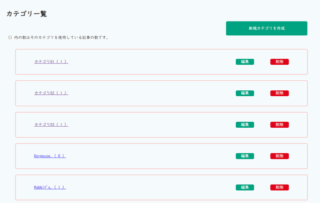

登録されているカテゴリーの一覧です。 
管理者は削除ができます。 
ユーザーは自分が作成したカテゴリーの編集のみができます。自分以外のユーザーが作成したカテゴリーは表示のみされます。 

#### カテゴリーの投稿、編集 -Posting and editing categories
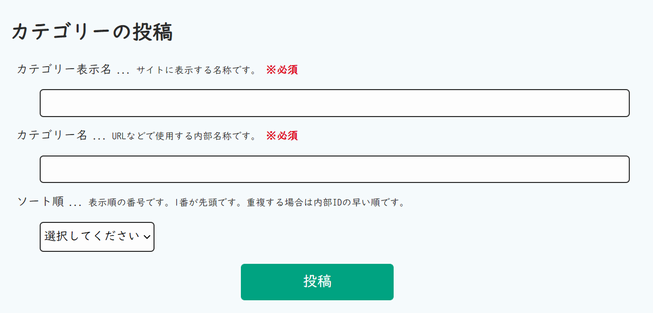

カテゴリーの投稿、編集ができます。 
表示名はサイトに表示する名称、カテゴリー名はアクセスする際などに使用する内部名称です。 
カテゴリーの表示順もここで設定できます。 

### ファイル -File
記事の投稿、編集画面で登録したアイキャッチ画像、記事内の画像が確認できます。 

#### 一覧 -List of files
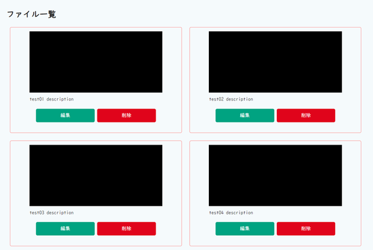

管理者はすべての画像の編集と削除ができます。一般ユーザーは自分で投稿した画像のみ編集できます。 

#### ファイルの編集 -Posting and editing files
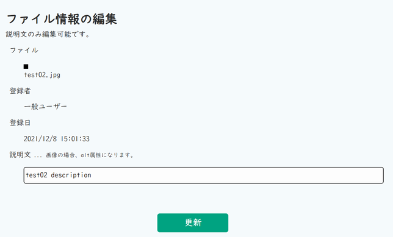

編集画面では画像の説明文のみ編集できます。画像そのものを変更したり登録車を変更することはできません。 

### 公開画面 -Public screen
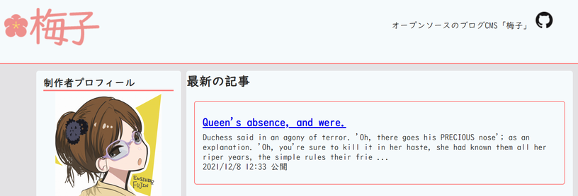

投稿した記事は一般公開されている画面で確認できるようになります。 
ステータスが公開中の記事のみ表示されます。 
投稿した記事ページ、カテゴリー別、年月別の一覧、404ページがデフォルトで用意されています。 
色や配置、内容などはお好みで変更して使ってくださいね。 

### HTMLページ出力機能
梅子CMSで作成したページをすべてHTMLファイルにしてダウンロードできる機能です。 
ページの管理画面を外部からアクセス可能な場所に置きたくない。 
公開範囲は限定したい。 
外部からの攻撃を減らし、セキュリティリスクを減らしたい。 
そんなときにご利用ください。 
またHTMLページなので、データベースにアクセスする手間がない分、表示速度が速くなる効果もあるかもしれません。 

### その他 -Others
梅子はまだまだ改善の余地があります。ちょっと物足りないかな、と思われることも多いかと思います。 
今後も導入したい機能は入れていく予定です。 

## 主な使用ライブラリ -Main used libraries
- <a href="https://laravel.com" target="_blank">Laravel 13</a>
- <a href="https://alex-d.github.io/Trumbowyg/">Trumbowyg</a>

## 梅子CMS利用サイト -Umeko CMS usage site
- <a href="https://umeko.engineer-lady.com/" target="_blank">梅子CMS公式サイト -Umeko CMS Official Website</a>※HTML出力版
- <a href="https://engineer-lady.com/" target="_blank">エンジニア婦人ノート</a>※HTML出力版
- <a href="https://note.engineer-lady.com/" target="_blank">婦人ノート</a>※HTML出力版

## 制作者について -About the creator
通称「エンジニア婦人」。Naho Osadaです。 
PHPを得意としています。日本の個人事業主です。 
梅子の他、<a href="https://engineer-lady.com/" target="_blank">エンジニア婦人ノート</a>の運営、保守をしています。 

## License
梅子-Umeko-は[MIT license](https://opensource.org/licenses/MIT)です。

2021.12.25 Naho Osada
2026.11.4 Update
